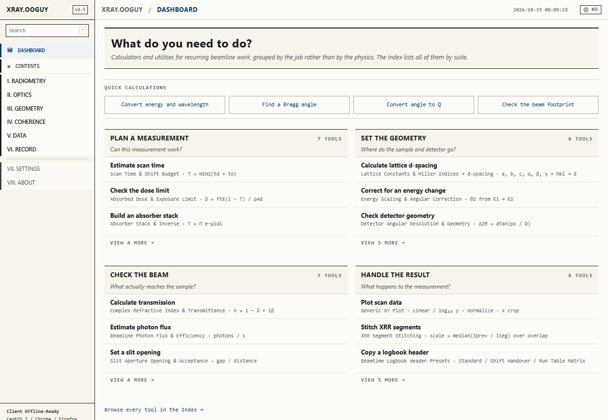
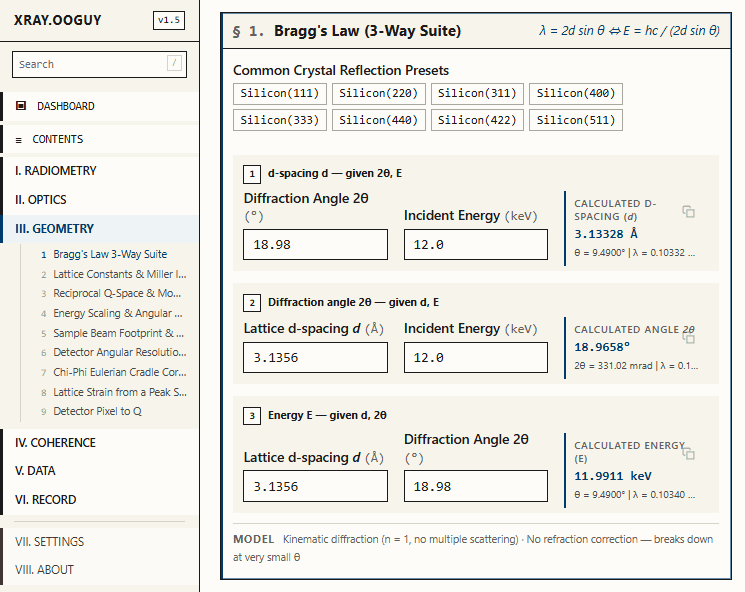

# xray.ooguy

English · [한국어](README.ko.md)

Offline X-ray calculators and beamtime logging tools for synchrotron beamline users, in one static page (English and Korean).



- **Site:** [https://xray.ooguy.com](https://xray.ooguy.com)
- **Made by:** Isaac Yong (용이삭), Department of Physics, Sogang University (CUPT lab)
- **Contact:** [isaacyong@naver.com](mailto:isaacyong@naver.com) · [@NaNIsaac](https://github.com/NaNIsaac) · [GitHub Sponsors](https://github.com/sponsors/NaNIsaac)

## What it is

Beamline control-room PCs are often cut off from the internet and run old systems such as CentOS 7.
This site is a set of calculators in a single page that works on such a PC with nothing installed:
open `index.html` in the browser. There is no build tool, no server and no external library.

- **Offline only.** Zero `fetch` calls at run time. Physical constants and crystal data are built into `js/data.js`.
- **Old browsers.** Works in the default browsers of CentOS 7 (Firefox 60 ESR, Chrome 60 to 70). ES5 syntax only.
- **Stored locally.** No account and no server. Language, theme and calculation history stay in `localStorage` (prefix `bl_toolkit_`).
- **English / Korean.** One address per language: `/` is English and `/ko/` is Korean,
  switched with the globe in the header. The Korean page is generated by `tools/build-i18n.js`.
- **Printable.** With Ctrl+P the navigation is hidden and the page prints as an A4 data sheet.

## Contents

Pick a view in the sidebar or the tabs at the top, or jump with `Alt` + a number key. `/` searches the sidebar.

| View | Shortcut | Contents |
|:---|:---:|:---|
| **I. RADIOMETRY** | `Alt+1` | Flux, attenuation, dose, exposure time (5 tools) |
| **II. OPTICS** | `Alt+2` | Energy, materials, monochromator (7 tools) |
| **III. GEOMETRY** | `Alt+3` | Crystal, angles, detector (9 tools) |
| **IV. COHERENCE** | `Alt+4` | CDI / BCDI (3 tools) |
| **V. DATA** | `Alt+5` | Reading scan files, XY plot, XRR stitching, film thickness |
| **VI. RECORD** | `Alt+6` | Beamtime logbook templates and event snippets |
| **VII. SETTINGS** | `Alt+7` | Language, theme, keyboard shortcuts |
| **VIII. ABOUT** | `Alt+8` | Author and the basis of each calculation |
| **DASHBOARD** | `Alt+9` | First screen with the tools grouped by task (plan a measurement, set up the geometry, check the beam, process results) |
| **CONTENTS** | `Alt+0` | Index of every tool with its formulas |



### I. RADIOMETRY

1. Scan time & shift budget
2. Absorbed dose & exposure limit
3. Absorber stack
4. Beamline photon flux
5. Slit opening & beam acceptance

### II. OPTICS

1. Energy – wavelength – frequency conversion (*E* = *hc*/λ, *hc* = 12398.41984 eV·Å)
2. Refractive index and X-ray transmittance (*n* = 1 − δ + i β, Beer–Lambert)
3. Critical angle of total external reflection (θ<sub>c</sub> = √2δ)
4. Diffraction grating dispersion (*m*λ = *d*(sin α + sin β))
5. Energy resolution (Δ*E*/*E*)
6. Crystal thermal drift: angle and energy shift
7. Monochromator energy calibration

### III. GEOMETRY

1. Bragg's law, 3-way suite (*n*λ = 2*d* sin θ), with a list of reflections
2. Lattice constants & Miller indices → d-spacing (all 7 crystal systems, from the metric tensor)
3. Reciprocal space (Q-space) conversion (*Q* = (4π/λ) sin θ)
4. Energy scaling & angle calculator
5. Beam footprint on the sample and spill-over check
6. Detector angular resolution
7. Chi-Phi Eulerian cradle correction
8. Lattice strain from a peak shift
9. Detector pixel → Q

### IV. COHERENCE

1. Coherence lengths at the sample
2. CDI / BCDI coherent oversampling (σ ≥ 2 check)
3. Reachable real-space resolution

### V. DATA

Open a finished scan file on the spot. Files never leave the browser (only `FileReader`, no upload).

1. **Load scan files.** Drag and drop or pick a file. Delimiter (tab, comma, semicolon, space) and header
   are detected, and `#` `%` `!` `;` comments are skipped. With three or more columns, choose the X and Y columns.
2. **XY plot.** Linear or log₁₀ Y axis, normalization (maximum = 1 or XRR plateau = 1), X range cropping.
   Copy the visible curve as TSV or save it as `.txt`.
3. **XRR stitching.** Joins segments measured with different absorbers into one curve.
   The scale factor is the **median** of the point-by-point ratios in the overlap, computed cumulatively
   against the whole curve stitched so far. A value typed into the table overrides the automatic one;
   clearing it goes back to automatic.
4. **Kiessig fringes → film thickness.** Estimates the thickness from two neighbouring minima of a
   reflectivity curve. With the critical angle given, the refraction correction is applied.

### VI. RECORD

Beamtime logbook header presets and one-click event snippets stamped with the current time,
for pasting into an external notebook (ELN, Google Docs or paper).

## Files

```text
xray_ooguy/
├── index.html      single entry point SPA: the markup of every view (English, /)
├── ko/index.html   Korean page, generated by tools/build-i18n.js; do not edit by hand (/ko/)
├── style.css       academic print design system
├── CNAME           custom domain (xray.ooguy.com)
├── llms.txt        site summary for AI agents
├── .githooks/pre-commit  runs tools/check.js before each commit
├── tools/
│   ├── build-i18n.js generates ko/index.html (node, no dependencies)
│   └── check.js      pre-commit checks (shared by the hook and CI)
├── tests/          calculator regression tests (node --test, no dependencies)
│   ├── dom.js      builds a stub DOM from index.html and runs js/ in a vm
│   └── calculators.test.js  compares card outputs with formulas and constants independent of js/
└── js/
    ├── app.js      hash router, tab and sidebar sync, shortcuts, calculation history
    ├── nav.js      builds the sidebar tree and search from the page outline
    ├── dashboard.js first screen with the tools grouped by task
    ├── i18n.js     Korean/English translation table and how it is applied
    ├── data.js     CODATA constants, d-spacing database, material attenuation database
    ├── optics.js   optics calculations
    ├── beamline.js beamline quantities and geometry
    ├── lattice.js  d-spacing from the metric tensor (7 crystal systems)
    ├── record.js   logbook headers and event snippets
    ├── dataview.js scan file parser, XY plot, XRR stitching
    ├── validity.js shows each calculator's model assumptions and range of validity
    └── miniplot.js inline SVG mini plots drawn from the formulas themselves
```

## Development

There is no build step. Edit a file and reload the browser.

```powershell
# open it directly
start index.html

# or a local server (to check the hash routing)
python -m http.server 8000
```

There is one check. Before committing:

```powershell
node .\tools\check.js
```

It checks four things: every script parses, no modern syntax that old browsers fail to parse has
slipped in (`let`/`const`, arrow functions, template literals, `?.`, `.includes()` and so on),
`ko/index.html` is up to date, and the calculator tests in `tests/` pass (`node --test`).
To run only the tests, use `node --test` from the repository root.

After changing Korean entries in `index.html` or `js/i18n.js`, regenerate the Korean page and commit it too:

```powershell
node .\tools\build-i18n.js
```

**To have it run automatically**, once per clone:

```powershell
git config core.hooksPath .githooks
```

Then `tools/check.js` runs on every commit and a failure blocks the commit. CI runs the same check.

When changing code, use ES5 syntax only and add no network requests at run time.

Deployment is a push to `main`, which GitHub Pages serves automatically.
